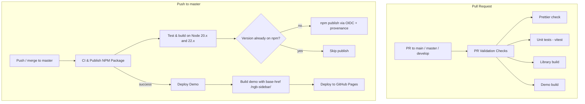

# 05. CI/CD Pipeline and NPM Package Automation

> **Note**: For a step-by-step release reference, see the **[Publishing Guide](./PUBLISHING-GUIDE.md)**.

This document describes how `@amro93/ngb-sidebar` is validated, published to the
[npm Registry](https://www.npmjs.com/package/@amro93/ngb-sidebar) and how the showcase demo is deployed,
using **GitHub Actions**, **npm Trusted Publishing (OIDC)** and **GitHub Pages**.

---

## Workflow Architecture



| Workflow file                       | Name                     | Trigger                                                              |
| ----------------------------------- | ------------------------ | -------------------------------------------------------------------- |
| `.github/workflows/pr-checks.yml`   | PR Validation Checks     | Pull requests to `main`, `master`, `develop`                         |
| `.github/workflows/npm-publish.yml` | CI & Publish NPM Package | Push to `main` / `master`, published GitHub release, manual          |
| `.github/workflows/deploy.yml`      | Deploy Demo              | After a **successful** CI & Publish run on `main` / `master`, manual |

---

## 1. NPM Package Setup

### Library manifest (`projects/ngb-sidebar/package.json`)

```json
{
  "name": "@amro93/ngb-sidebar",
  "version": "0.1.0",
  "license": "MIT",
  "publishConfig": { "access": "public" },
  "peerDependencies": {
    "@angular/common": ">=20.0.0",
    "@angular/core": ">=20.0.0",
    "bootstrap": ">=5.0.0"
  },
  "dependencies": { "tslib": "^2.3.0" },
  "sideEffects": false
}
```

- The root `package.json` is `private` and owns the version; `npm run sync:version` copies it into the
  library manifest and the `NGB_SIDEBAR_VERSION` / `APP_VERSION` constants.
- `ng-packagr` (`projects/ngb-sidebar/ng-package.json`) writes the package to `dist/ngb-sidebar`.
- `LICENSE` and `README.md` in `projects/ngb-sidebar/` are copied into the package.

### Trusted Publishing (no tokens)

Publishing uses npm's OIDC Trusted Publishing instead of an `NPM_TOKEN` secret:

1. Publish the first version manually (`npm login && npm run publish:lib`).
2. On npmjs.com: **package → Settings → Trusted Publisher → GitHub Actions**, repository
   `amro93/ngb-sidebar`, workflow `npm-publish.yml`.
3. The `publish` job requests `id-token: write`, upgrades npm (OIDC needs npm >= 11.5.1) and runs
   `npm publish ./dist/ngb-sidebar --access public`. Provenance is attached automatically.

---

## 2. GitHub Actions Workflows

### 2.1. PR Validation (`pr-checks.yml`)

Runs on Node 20.x and 22.x:

```yaml
- run: npm ci
- run: npm run prettier:check
- run: npm run test # ng test ngb-sidebar --watch=false
- run: npm run build:lib
- run: npm run build:demo -- --base-href=/ngb-sidebar/
```

### 2.2. CI & Publish (`npm-publish.yml`)

- **test** job (matrix Node 20.x / 22.x): `npm ci`, `npm run test`, `npm run build:lib`.
- **publish** job (needs `test`): builds the library, reads name/version from
  `dist/ngb-sidebar/package.json`, and only publishes when `npm view name@version` finds nothing. Pushing a
  commit without a version bump therefore never fails — it just skips the publish.
- `concurrency: npm-publish` prevents two publishes from racing.

### 2.3. Deploy Demo (`deploy.yml`)

- Triggered by `workflow_run` of **CI & Publish NPM Package** and only continues when it succeeded, so a
  red build never reaches the demo site. It checks out the exact commit CI validated.
- Builds with `npm run build:demo -- --base-href=/ngb-sidebar/`, copies `index.html` to `404.html` (SPA
  fallback), adds `.nojekyll`, and deploys with `actions/deploy-pages`.
- The demo imports the library from source (`tsconfig.json` path mapping to
  `projects/ngb-sidebar/src/public-api.ts`), so it does not need a prior library build.

---

## 3. Semantic Release (optional)

`.releaserc.json` and the `npm run release` script are kept for
[semantic-release](https://semantic-release.gitbook.io/) based on **Conventional Commits**. The default
workflows do **not** run it; versions are bumped with `npm run version:*`. To adopt it, run
`npx semantic-release` after `npm run build:lib` in a workflow (it publishes from `dist/ngb-sidebar`).

| Commit Format                              | Example                                    | SemVer Bump    |
| :----------------------------------------- | :----------------------------------------- | :------------- |
| `fix(...)`                                 | `fix(nav): keep active item expanded`      | **Patch**      |
| `feat(...)`                                | `feat(sidebar): add hoverCloseDelay input` | **Minor**      |
| `feat(...)!` / `BREAKING CHANGE:`          | `feat(api)!: rename open to expanded`      | **Major**      |
| `docs(...)`, `chore(...)`, `refactor(...)` | `docs(readme): document theming`           | **No release** |

---

## 4. GitHub Repository Configuration

### 4.1. Branch Protection

**Settings → Branches → Add rule** for `master`:

- Require a pull request before merging.
- Require status checks to pass (select **PR Validation Checks**).

### 4.2. GitHub Pages

**Settings → Pages → Build and deployment → Source: GitHub Actions.**
The demo is published at `https://amro93.github.io/ngb-sidebar/`.

---

## 5. Local Verification

```bash
npm run prettier:check
npm test
npm run build:lib
npm run build:demo -- --base-href=/ngb-sidebar/
cd dist/ngb-sidebar && npm pack --dry-run
```
